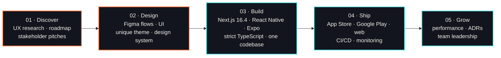
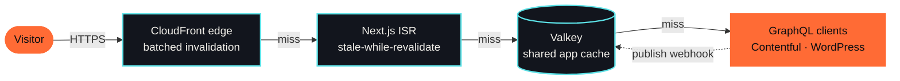

  

  <picture>
    <source media="(prefers-color-scheme: dark)" srcset="https://readme-typing-svg.demolab.com?font=JetBrains+Mono&weight=600&size=21&duration=2600&pause=1300&color=5CE1E6&center=true&vCenter=true&width=920&lines=I+design+your+product+in+Figma%2C+then+ship+it+on+web+%2B+mobile;Konnect%3A+2+codebases+%E2%86%92+1%2C+Android+app+128+%E2%86%92+36+MB;Chili's%3A+1.29M%2B+users%2C+%2416M+in+the+first+month;Available+15%E2%80%9320+h+%2F+week+for+US%2C+UK%2C+EU+and+APAC+teams" />
    
  </picture>

  
  
  
  
  

  
  
  
  

> [!TIP]
> **The thirty-second version.** I take a product from a blank Figma file to the App Store, Google Play and the web, as one person: UX research, flows, a theme that is yours alone, the Next.js and React Native build, and the store release. Today I lead web and mobile at **Konnect**, an AI travel super-app in Seoul, where I design the product with the CEO and then ship it. Before that, at Gale Partners, I built web and mobile products for **Chili's, Starbucks, Hard Rock, Creative Planning, Fogo de Chão, Pella and MilkPEP**. Every result below is measured before and after.

  <b>This pitch in your language:</b>
  <a href="https://sarangchaudhary.vercel.app/hire/">English</a> ·
  <a href="https://sarangchaudhary.vercel.app/hire/de/">Deutsch</a> ·
  <a href="https://sarangchaudhary.vercel.app/hire/nl/">Nederlands</a> ·
  <a href="https://sarangchaudhary.vercel.app/hire/fr/">Français</a> ·
  <a href="https://sarangchaudhary.vercel.app/hire/ar/">العربية</a> ·
  <a href="https://sarangchaudhary.vercel.app/hire/ko/">한국어</a> ·
  <a href="https://sarangchaudhary.vercel.app/hire/ja/">日本語</a>

## Results, measured

<table align="center">
  <tr>
    <td align="center"><h2>−72%</h2>Android app size 128 → 36 MB · Konnect</td>
    <td align="center"><h2>2 → 1</h2>codebases web + mobile monorepo · Konnect</td>
    <td align="center"><h2>60 → 0</h2>re-renders while AI answers stream</td>
    <td align="center"><h2>1.29M+</h2>monthly users 29+ countries · Chili's</td>
    <td align="center"><h2>$16M</h2>first-month revenue after the migration</td>
    <td align="center"><h2>−94%</h2>API latency 800 → 50 ms · 3-layer cache</td>
  </tr>
</table>

## From design to ship, one owner

No handoffs between a designer, a frontend team and a release manager, so nothing gets lost in between.

## Work with me

| | What you get | Time | From |
|---|---|---|---|
| 🎨 **Design blueprint** | Your whole app and website in Figma, every screen annotated with what it does, a theme unique to your product, a design system and a clickable prototype | 4–6 weeks | **$9,500** · £7,400 · €8,700 |
| 🚀 **Design to launch** | Everything in the blueprint, built in Next.js and Expo / React Native, sign-in, analytics and CI/CD set up, live on the App Store, Google Play and your domain, 30 days of fixes | 12–16 weeks | **$32,000** · £25,000 · €29,500 |
| 🔍 **Discovery audit** | App size, memory, Core Web Vitals and release pipeline measured on real devices, with a written plan your team can run | 2 weeks | **$6,000** · £4,700 · €5,500 |
| 🛠️ **Build engagement** | A fixed weekly block where I own one stream end to end: consolidation, performance or a new product surface | 3–6 months | **$720 / day** · £560 · €660 |
| 🤝 **Retainer** | Reviews, release support, regressions and the next Expo or Next.js upgrade | monthly | **$3,200** · £2,500 · €2,950 |

"From" prices, invoiced in your currency. Your IP, your repos, your accounts; store developer accounts are opened in your name. Rates in AUD, CHF, AED, KRW and JPY are on the <a href="https://sarangchaudhary.vercel.app/hire/#rates">pitch page</a>.

  <a href="https://sarangchaudhary.vercel.app/hire/"><b>Book a 30-minute call →</b></a>

## Now building

<b>🧭 Konnect · AI travel super-app for foreigners in Korea</b> — Lead Frontend Engineer, web + mobile · <a href="https://konnect.kr">konnect.kr</a> · <a href="https://play.google.com/store/apps/details?id=com.konnect.kr">Android</a>

AI search with streamed answers, events, taxi cashback, onboarding and profiles, in **26 languages** on web, Android and iOS. I report to the CEO and CTO, set the frontend roadmap and join the CEO on advertiser pitches.

**Product design in Figma, with the CEO**
- Design the web and mobile product end to end: UX research, user flows and wireframes for each journey (onboarding, AI search, events, taxi cashback, profiles), then high-fidelity UI for every screen.
- Defined the product theme and a Figma design system (colour, type, spacing, component states) that ships as the shared theme package used by both apps.

**Engineering**
- Unified a Create React App website and an Expo / React Native app into **one pnpm + Turborepo monorepo** with 7 shared packages (theme, i18n in 26 languages, analytics, config, utils, ESLint, TypeScript), migrating about 60,000 lines with **135 visual and network parity checks** across 9 breakpoints and zero behaviour change.
- Cut the Android app **128 MB → 36 MB (−72%)** and the iOS install **78.5 MB → 45 MB (−43%)** with R8, native dead-code removal, framework stripping and a pixel-verified lossless asset pipeline.
- Reduced onboarding memory by **up to 245 MB** and removed **100% of redundant re-renders** while AI answers stream (60 → 0 per 20 updates).
- Moved the web app from CRA to **Next.js 16.4** on React 19 and converted **192 / 192 files** to strict TypeScript with zero `any`, compiling every file both ways to prove runtime behaviour unchanged.
- Fixed 10+ live production bugs, added native Sign in with Apple, and documented every decision in **11 ADRs** with revert steps.

Next.js 16.4 · React 19 · React Native 0.81 · Expo SDK 54 · TypeScript · Redux Toolkit · Reanimated 4 · Firebase Auth · pnpm · Turborepo · GitLab CI · AWS · Playwright · Figma

<b>🎬 ContentForge · local-first bilingual AI video engine</b> — my own product · 4 pieces a day, ₹0 per video

- Daily market-analysis videos, reels and cartoon shorts in Hindi and English, narrated in a cloned voice and rendered on my own machine.
- A 15+ package Turborepo: data engine (NSE, BSE, RSS, Google Trends) → topic scoring → local LLM scripts (Ollama · Gemma 4) → emotion-aware TTS (Chatterbox) → FFmpeg mix → Remotion render → mlx-whisper captions, behind a Hono API and React dashboard.
- A compliance gate blocks advice language and ungrounded numbers before render; every make gets QC and a render receipt.
- An **MCP server with 41 tools** lets Claude Code or Cursor plan, cut, preview and pack pieces while approval stays with me.

TypeScript · Node.js · Turborepo · Remotion · FFmpeg · Ollama · Gemma 4 · Chatterbox · mlx-whisper · FLUX.2 · MediaPipe · SigLIP 2 · Hono · SQLite · MCP

## Work that shipped · Gale Partners, 2022–2026

Brands: Chili's (Brinker International) · Starbucks · Hard Rock · Creative Planning · Fogo de Chão · Pella · MilkPEP

<b>🏦 Creative Planning · enterprise CMS platform</b> — Next.js 16 monorepo, 3-layer cache, 150k-entry sitemap engine · <a href="https://creativeplanning.com/">creativeplanning.com</a>

- Built a **production pnpm monorepo (6 packages)** on Next.js 16 + React 19 with Turbopack, proxy middleware, async APIs and CSS-first Tailwind v4, so every service deploys independently.
- Designed the **3-layer cache** (Valkey + ISR + CloudFront with batched invalidation) and a **hash-per-category sitemap engine** with O(1) updates, validated at **150,000+ entries**: response time **800 ms → under 50 ms**, CDN cost **−80%**.
- Integrated **Contentful** through dual GraphQL clients and the Live Preview SDK, so editors publish without a redeploy.
- Delivered **24+ accessible React components** (React Aria + Tailwind v4), Storybook visual regression, nonce-based CSP and HSTS, deployed by **GitHub Actions to AWS ECR/ECS in under 8 minutes**.

<b>🌶️ Chili's · global web &amp; mobile platform</b> — 29+ countries, 1.29M+ users, $16M in month one · <a href="https://www.chilis.com/">Web</a> · <a href="https://play.google.com/store/apps/details?id=com.brinker.chilis">Android</a> · <a href="https://apps.apple.com/us/app/chilis/id464383246">iOS</a>

- **Cross-platform ordering product** (React, React Native, Next.js) serving 29+ countries and 1.29M+ monthly users, with **$16M in revenue** in the first month after the migration.
- SEO-first location system on Next.js SSR with custom XML sitemaps and Google Maps.
- Secure **multi-payment checkout** (cards, Google Pay, gift cards) with account management; **17-minute average session**.
- Jest at **90%+ coverage** and Google Tag Manager for behavioural analytics.

<b>☕ Starbucks · 🎸 Hard Rock · 📊 Pella business dashboard · 🎬 MilkPEP</b> — marketing, hospitality and analytics platforms

- **Starbucks:** Next.js 15 SSG platform in en-US, en-CA and fr-CA with JSON-LD, automated sitemaps and 25+ accessible components in Storybook. <a href="https://protein.starbucks.com/">US</a> · <a href="https://protein.starbucks.ca/">CA</a> · <a href="https://proteines.starbucks.ca/">CA-FR</a>
- **Hard Rock Unity:** contactless hospitality for 200+ locations in 75 countries (CLEAR identity, Virdee mobile keys, Everi payments, tiered loyalty). <a href="https://play.google.com/store/apps/details?id=com.shre.unitymobile.prod">Android</a> · <a href="https://apps.apple.com/us/app/unity-by-hard-rock/id1609454172">iOS</a>
- **Pella business dashboard:** multi-role analytics for administrators and branch managers, with role-based access, ECharts, Leaflet heat maps, filterable tables and promotion management.
- **MilkPEP:** real-time branded video customiser with an optimised asset pipeline and Vitest at 90%+.

<b>🤖 AI-native engineering</b> — 3.6+ years of Claude, Copilot, MCP and custom agents in daily production work

- Built a **production AI onboarding system**: `copilot-instructions.md`, four specialised Copilot agents (frontend, docs, code review, OpenCode) and a structured `ai_wiki`, adopted across projects.
- Configured **MCP servers** for Jira, Figma and Contentful so AI-assisted development reads tickets, design specs and live content schemas without context switching.
- Keep full architectural ownership: AI drafts, I decide, and every change is measured.

## Toolkit

<table>
  <tr>
    <td><b>Design</b></td>
    <td>
      
      
      
      
      
    </td>
  </tr>
  <tr>
    <td><b>Web &amp; mobile</b></td>
    <td>
      
      
      
      
      
      
    </td>
  </tr>
  <tr>
    <td><b>Motion &amp; 3D</b></td>
    <td>
      
      
      
      
    </td>
  </tr>
  <tr>
    <td><b>Platform</b></td>
    <td>
      
      
      
      
      
      
    </td>
  </tr>
  <tr>
    <td><b>Quality</b></td>
    <td>
      
      
      
      
    </td>
  </tr>
  <tr>
    <td><b>AI</b></td>
    <td>
      
      
      
      
    </td>
  </tr>
</table>

## What people I shipped with say

> **"Proactive, diligent, and flexible in his approach to every project. He consistently goes above and beyond expectations, adapting quickly to changing requirements while maintaining high standards of quality."**
> Bryan McKenzie · Director of Business Analysis &amp; Product Strategy, Gale Partners

> **"A breadth of skills that extend well beyond frontend development. He consistently completes tasks on time while maintaining clear and effective communication. He has the potential to be a great leader and mentor in any engineering team."**
> Riley Galante · Senior Software Engineer, Brinker International

> **"Quickly onboarded and delivered high-quality code at an impressive pace. His contributions were instrumental to the Chili's mobile app MVP, producing clean, well-structured code that set a strong foundation for the product."**
> Jobin Abraham · Senior Software Engineer, Brinker International

<a href="https://www.linkedin.com/in/sarang-chaudhary-401405178/details/recommendations/">Verify every recommendation on LinkedIn →</a>

## How I work with clients

- **A fixed weekly block, 15–20 hours**, booked in advance. I own one stream completely rather than attending everything.
- **A demo and a written update every week.** Every decision gets an ADR with revert steps.
- **Measured before and after**, on real devices. If a number doesn't move, you hear it from me first.
- **Your IP, your repos, your accounts.** Handover docs, so your team keeps the result.
- **Time zones:** I keep 3–4 hours of daily overlap with UK and EU mornings or US-East early afternoon; Gulf, Korean and Japanese business hours overlap directly.

## Let's talk

  
  
  
  

  🌐 <a href="https://sarangchaudhary.vercel.app/">Portfolio</a> ·
  💼 <a href="https://sarangchaudhary.vercel.app/hire/">Work with me</a> ·
  📄 <a href="https://sarangchaudhary.vercel.app/cv/">Contract CV (print to PDF)</a> ·
  ⭐ <a href="https://www.linkedin.com/in/sarang-chaudhary-401405178/details/recommendations/">Recommendations</a>

🎓 B.E., First Class with Distinction, Savitribai Phule Pune University · Full-Stack Development, Masai School

  

<!--
Keywords: Lead Software Engineer, Design Engineer, Freelance React Native Developer, Contract Next.js Developer,
Figma UI/UX Designer who codes, Product Designer and Engineer, MVP development, App Store and Google Play launch,
React, Next.js 16, React Native, Expo, TypeScript, Monorepo, Turborepo, App size optimisation, Web performance,
Design systems, Konnect, Chili's, Starbucks, Hard Rock, Creative Planning, Fogo de Chao, Pella, MilkPEP, Seoul, remote contract, US, UK, Europe, Germany, Netherlands, Switzerland, UAE, Korea, Japan
-->
