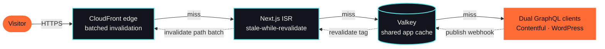

<div align="center">
  
</div>

<p align="center">
  <picture>
    <source media="(prefers-color-scheme: dark)" srcset="https://readme-typing-svg.demolab.com?font=JetBrains+Mono&weight=600&size=22&duration=2600&pause=1200&color=5CE1E6&center=true&vCenter=true&width=900&lines=I+ship+the+storefronts+behind+Chili's%2C+Starbucks+%26+Hard+Rock;29%2B+countries+%C2%B7+1.29M%2B+users+%C2%B7+%2416M+revenue+in+month+one;800+ms+%E2%86%92+under+50+ms+with+a+3-layer+cache+I+designed;React+%C2%B7+Next.js+%C2%B7+React+Native+%C2%B7+TypeScript+%C2%B7+AI-augmented+delivery" />
    
  </picture>
</p>

<p align="center">
  <a href="https://sarangchaudhary.vercel.app/"></a>
  <a href="https://www.linkedin.com/in/sarang-chaudhary-401405178/"></a>
  <a href="https://drive.google.com/file/d/10e7faVK4nKOi4UGJ8tb-E3sKYqGwnUBY/view"></a>
  <a href="https://www.linkedin.com/in/sarang-chaudhary-401405178/details/recommendations/"></a>
  <a href="mailto:sarangchaudhary2014@gmail.com"></a>
</p>

<p align="center">
  
  
  
</p>

> [!TIP]
> **Thirty-second version.** Senior engineer at **GALE** in Bengaluru who builds and ships production web and mobile products for North American brands: **Chili's, Starbucks, Hard Rock, Creative Planning, Pella.** I own the whole slice: Next.js and React Native front ends, the caching and CDN layers under them, CI/CD to AWS, 90%+ test coverage, and the AI tooling that lets the team move faster without losing architectural control.

## Impact in numbers

<table align="center">
  <tr>
    <td align="center"><h2>29+</h2>countries served<br/><sub>Chili's global platform</sub></td>
    <td align="center"><h2>1.29M+</h2>users · 2.09M+ sessions<br/><sub>web &amp; mobile</sub></td>
    <td align="center"><h2>$16M</h2>revenue in month one<br/><sub>after stack migration</sub></td>
    <td align="center"><h2>800→50 ms</h2>API response<br/><sub>3-layer cache, 150k+ entries</sub></td>
    <td align="center"><h2>-80%</h2>CDN cost<br/><sub>batched invalidation</sub></td>
    <td align="center"><h2>90%+</h2>test coverage<br/><sub>every major project</sub></td>
  </tr>
</table>

## How I think about a request

Instead of listing "caching" as a skill, here is the layer I designed for Creative Planning. Every hop is a cache; the origin is the last resort.



<sub>Result on production traffic: p95 **800 ms → under 50 ms**, CDN spend **−80%**, sitemap engine validated at **150,000+ entries** with O(1) per-category updates.</sub>

## About me

```ts
const sarang = {
  pronouns: "he/him",
  role: "Senior Associate (Software Engineer) @ GALE",
  base: "Bengaluru, India 🇮🇳 · working with North American teams and clients",
  years: 4,
  builds: ["Next.js storefronts", "React Native apps", "headless CMS platforms", "AI-augmented workflows"],
  askMeAbout: ["web performance", "caching & CDNs", "mobile apps", "AI tooling for teams"],
  offHours: { tea: "fuel for deep work 🍵", markets: "charts & stocks 📈", world: "geopolitics 🌍" },
  goal: "ship scalable products that matter, at global scale",
} satisfies Record<string, unknown>;
```

## Stack

<table>
  <tr>
    <td><b>Core</b></td>
    <td>
      
      
      
      
      
      
    </td>
  </tr>
  <tr>
    <td><b>UI</b></td>
    <td>
      
      
      
      
      
      
    </td>
  </tr>
  <tr>
    <td><b>APIs &amp; data</b></td>
    <td>
      
      
      
      
    </td>
  </tr>
  <tr>
    <td><b>Cloud &amp; delivery</b></td>
    <td>
      
      
      
      
    </td>
  </tr>
  <tr>
    <td><b>Quality &amp; tools</b></td>
    <td>
      
      
      
      
      
      
      
    </td>
  </tr>
  <tr>
    <td><b>AI workflow</b></td>
    <td>
      
      
      
      
    </td>
  </tr>
</table>

## Work that shipped

Expand any card for the engineering detail.

<details open>
<summary><b>🏦 Creative Planning · enterprise CMS platform</b> — Next.js 16 monorepo, 3-layer cache, 150k-entry sitemap engine · <a href="https://creativeplanning.com/">creativeplanning.com</a></summary>

- Built a **production pnpm monorepo (6 packages)** on Next.js 16 + React 19 with Turbopack, proxy middleware, async APIs and CSS-first Tailwind v4, so every service deploys independently.
- Designed the **3-layer cache** (Valkey + ISR + CloudFront with batched invalidation) and a **hash-per-category sitemap engine** with O(1) updates, Contentful/WordPress merging and international variants, validated at **150,000+ entries**: response time **800 ms → under 50 ms**, CDN cost **−80%**.
- Integrated **Contentful** through dual GraphQL clients, 12+ content types, full SEO metadata (OG, Twitter, canonical, robots) and the Live Preview SDK with Inspector Mode, so editors publish without a redeploy.
- Delivered **24+ accessible React components** (React Aria + Tailwind v4), a type-safe PageBuilder, **Storybook 10** visual regression, nonce-based CSP, HSTS and PII-safe logging, deployed by **GitHub Actions to AWS ECR/ECS in under 8 minutes**.
</details>

<details>
<summary><b>🌶️ Chili's · global web &amp; mobile platform</b> — 29+ countries, 1.29M+ users, $16M in month one · <a href="https://www.chilis.com/">Web</a> · <a href="https://play.google.com/store/apps/details?id=com.brinker.chilis">Android</a> · <a href="https://apps.apple.com/us/app/chilis/id464383246">iOS</a></summary>

- **Cross-platform product** serving 29+ countries, 1.29M+ users and 2.09M+ sessions, with **$16M in revenue** inside the first month after the tech-stack migration.
- Built the **SEO location system** on Next.js SSR with custom XML sitemaps and Google Maps, lifting SERP rankings and organic traffic.
- Shipped a **secure multi-payment checkout** (cards, Google Pay, gift cards) with account management, driving a **17-minute average session**.
- Tuned state management, code splitting and caching; set up **Jest at 90%+ coverage** and Google Tag Manager for behavioural analytics.
</details>

<details>
<summary><b>☕ Starbucks · multi-locale marketing platform</b> — Next.js 15 SSG, en-US / en-CA / fr-CA · <a href="https://protein.starbucks.com/">US</a> · <a href="https://protein.starbucks.ca/">CA</a> · <a href="https://proteines.starbucks.ca/">CA-FR</a></summary>

- Architected a **Next.js 15 SSG app** with three locales, dynamic routing, automated sitemaps, canonical URLs, JSON-LD and a **headless JSON-driven content model** across 15+ TypeScript interfaces.
- Built **25+ reusable, accessible React components** with MUI theming, interactive quizzes, parallax and viewport-driven animation, documented and verified in Storybook.
- Added automated build validation, Jest unit tests, **CSP headers** and accessibility checks for consistently fast static exports at **90%+ coverage**.
</details>

<details>
<summary><b>🎸 Hard Rock · Unity mobile app</b> — contactless hospitality for 200+ locations in 75 countries · <a href="https://play.google.com/store/apps/details?id=com.shre.unitymobile.prod">Android</a> · <a href="https://apps.apple.com/us/app/unity-by-hard-rock/id1609454172">iOS</a></summary>

- Built the **contactless hospitality flow** (CLEAR identity verification, Virdee mobile keys) with location-aware venue features, Everi payments and a tiered loyalty programme.
- Improved performance with a **WebView architecture** and dynamic content from Sitecore/Firebase, plus A/B testing for data-driven UX decisions.
</details>

<details>
<summary><b>📊 Pella · business analytics dashboard</b> — RBAC, ECharts, Leaflet heat maps</summary>

- Built the **analytics dashboard** with role-based access control so administrators and branch managers track marketing ROI and performance.
- Implemented **data visualisation** with ECharts, Leaflet heat maps and filterable MUI tables, plus promotion management for multiple offer types.
- Designed the **RBAC infrastructure** with dynamic menus and a protected asset repository.
</details>

<details>
<summary><b>🎬 MilkPEP · video customiser</b> — real-time branded video previews, Vitest at 90%+</summary>

- Built a **responsive interactive UI** with dynamic form generation and a real-time video previewer for client-side template customisation (container types, sizes, colours, branded elements) alongside motion designers.
- Implemented an **optimised asset pipeline** that cut cloud-storage cost while keeping preview quality, with validated state management and **90%+ coverage via Vitest**.
</details>

<details>
<summary><b>🤖 AI-augmented engineering</b> — 2.5+ years embedding Copilot, Claude, ChatGPT and OpenCode into production workflows</summary>

- Use **GitHub Copilot, OpenCode, Claude and ChatGPT** daily for generation, debugging and test authoring while keeping full architectural ownership; the team ships faster with higher quality.
- Built a **production AI onboarding system**: `copilot-instructions.md`, four specialised Copilot agents (FE Agent, Docs Generator, Code Reviewer, OpenCode Agent) and a structured `ai_wiki`, adopted across projects to enforce standards and speed up onboarding.
- Configured **OpenCode MCP servers** for Jira, Figma and a Contentful sandbox, so AI-assisted development reads design specs, tickets and live content schemas without context switching.
</details>

## What teammates say

> **"Proactive, diligent, and flexible in his approach to every project. He consistently goes above and beyond expectations, adapting quickly to changing requirements while maintaining high standards of quality."**
> <sub>Bryan McKenzie · Director of Business Analysis &amp; Product Strategy, Gale Partners</sub>

> **"A breadth of skills that extend well beyond frontend development. He consistently completes tasks on time while maintaining clear and effective communication. He has the potential to be a great leader and mentor in any engineering team."**
> <sub>Riley Galante · Senior Software Engineer, Brinker International</sub>

> **"Quickly onboarded and delivered high-quality code at an impressive pace. His contributions were instrumental to the Chili's mobile app MVP, producing clean, well-structured code that set a strong foundation for the product."**
> <sub>Jobin Abraham · Senior Software Engineer, Brinker International</sub>

<p align="center"><a href="https://www.linkedin.com/in/sarang-chaudhary-401405178/details/recommendations/">Read all recommendations on LinkedIn →</a></p>

## Activity

<p align="center">
  
</p>

## Education

| | | |
|---|---|---|
| 🎯 | **Full-Stack Web Development** · Masai School, Bengaluru | Aug 2021 – Apr 2022 |
| 🎓 | **B.E., First Class with Distinction** · Savitribai Phule Pune University | Aug 2017 – Nov 2020 |

## Let's talk

<p align="center">
  <a href="https://www.linkedin.com/in/sarang-chaudhary-401405178/"></a>
  <a href="mailto:sarangchaudhary2014@gmail.com"></a>
  <a href="https://twitter.com/sarangssc"></a>
  <a href="https://stackoverflow.com/users/22754685/sarang-chaudhary"></a>
  <a href="https://sarangchaudhary.vercel.app/"></a>
</p>

<p align="center">
  🌐 <a href="https://sarangchaudhary.vercel.app/">Portfolio</a> ·
  📄 <a href="https://drive.google.com/file/d/10e7faVK4nKOi4UGJ8tb-E3sKYqGwnUBY/view">Resume</a> ·
  ⭐ <a href="https://www.linkedin.com/in/sarang-chaudhary-401405178/details/recommendations/">Testimonials</a> ·
  💼 <a href="https://www.linkedin.com/in/sarang-chaudhary-401405178/">LinkedIn</a>
</p>

<p align="center"><sub>Take a challenge. Conquer it. Repeat. Never settle.</sub></p>

<div align="center">
  
</div>

<!--
SEO: Senior Software Engineer, Frontend Engineer, Full-stack Engineer, React Developer, Next.js Developer,
TypeScript, React Native, JavaScript, Node.js, GraphQL, Contentful, Tailwind CSS, Redux, AWS CloudFront,
Docker, GitHub Actions, Valkey, Redis, Storybook, Jest, Vitest, Web Performance, SEO, Headless CMS,
Enterprise Platform, Monorepo, pnpm, AI Tooling, GitHub Copilot, Claude, MCP, Bengaluru, India,
North America clients, Remote, Open to work
-->
